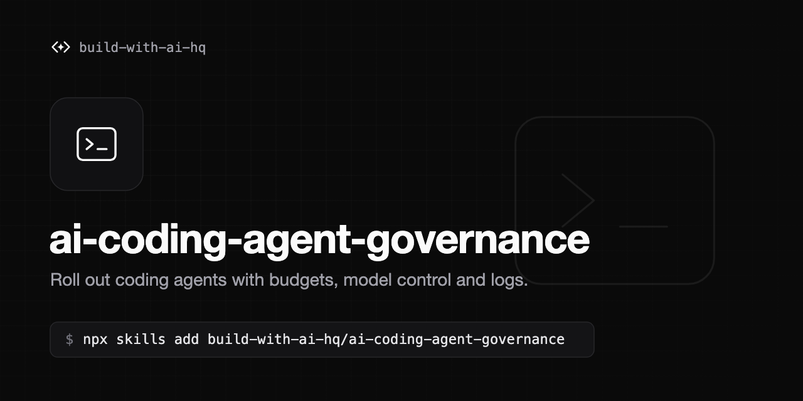

# ai-coding-agent-governance

[](https://skills.sh/build-with-ai-hq/ai-coding-agent-governance)

An Agent Skill for rolling out AI coding agents (Claude Code, Codex CLI, Cursor, Gemini CLI, GitHub Copilot, OpenCode) across an engineering team with control over spend, models, providers, data, MCP tools and logs.

## Problems this solves

- Surprise AI bills with no per-developer spend limits
- One provider key shared across laptops, `.env` files and CI
- No visibility into usage or cost per developer, team or pipeline
- Can't switch or mix models and providers, or keep traffic on Bedrock/Vertex/Azure for data residency
- Unknown MCP servers running on developer machines
- Source code sent to providers that were never approved
- Every agent onboarded and configured separately, with config drift afterwards
- Agents in CI with unbounded budgets
- No way to show whether the rollout is paying off

## Install

```bash
npx skills add build-with-ai-hq/ai-coding-agent-governance
```

## What the skill does

When loaded, the skill guides an agent to:

1. Audit machines and repositories for raw provider keys, agent configs, managed policy and MCP servers.
2. Draft a short policy: approved agents, providers, regions, models, budgets, data rules, MCP servers, logging retention.
3. Put one gateway in front of every agent, using Bifrost (open-source AI gateway) as the default, with one virtual key per developer and per CI pipeline carrying budgets, rate limits and model and MCP tool allowlists.
4. Write exact per-agent configuration (base URL shapes, credential variables, model alias mapping to Bedrock/Vertex/OpenAI).
5. Enforce it with Claude Code managed settings (`allowedProviders`, pinned base URL, `apiKeyHelper`, `availableModels`, MCP allowlists, bypass mode disabled) delivered by MDM.
6. Set up CI usage, spend attribution from gateway logs, and adoption and value metrics.
7. Verify each control end to end.

## Contents

```
SKILL.md                                  Audit, rollout plan, managed settings, MCP, data, logging, CI, metrics, verification
references/per-tool-setup.md              Exact gateway config for Claude Code, Codex CLI, Gemini CLI, Cursor, Copilot (app, CLI, VS Code), OpenCode, others
references/virtual-keys-per-developer.md  Teams, roster-based key provisioning (bash, Python, TypeScript), budgets, expiry, rotation, offboarding, spend reports
references/rollout-checklist.md           Phased checklist with policy template and exit criteria
```

## License

MIT
